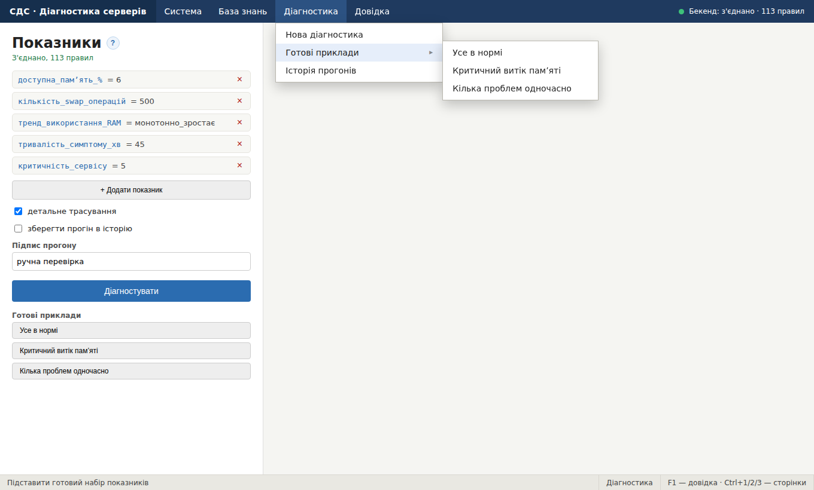
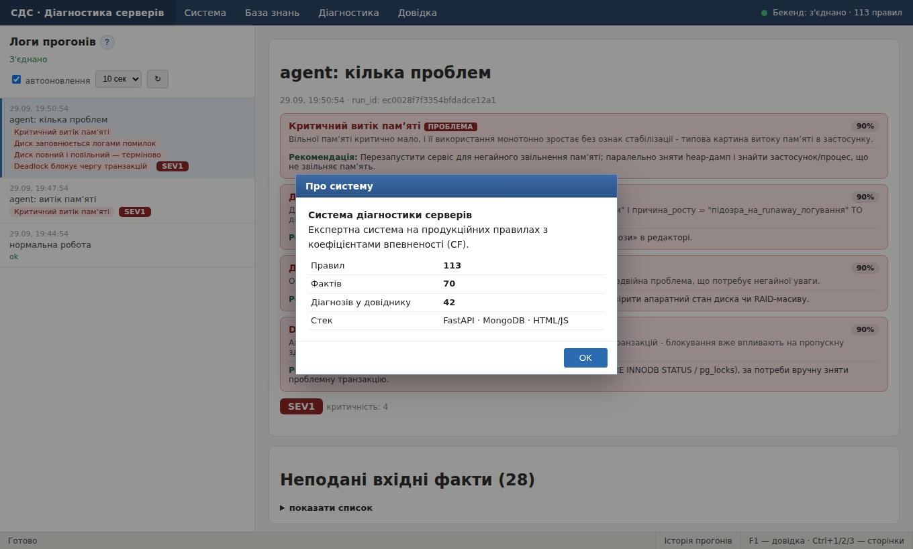
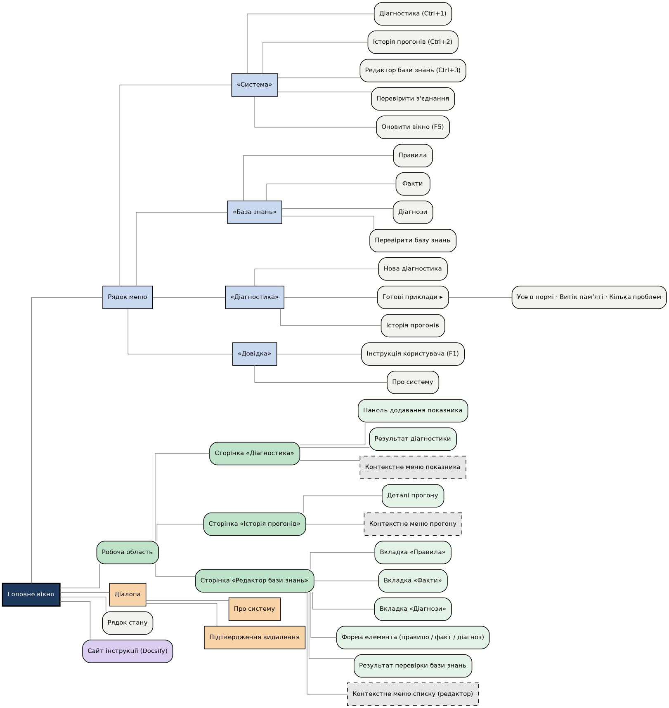
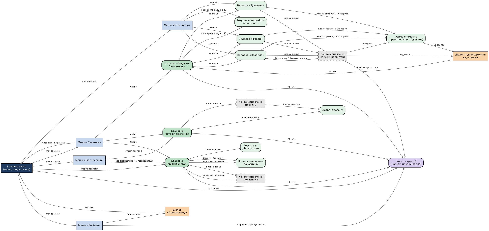
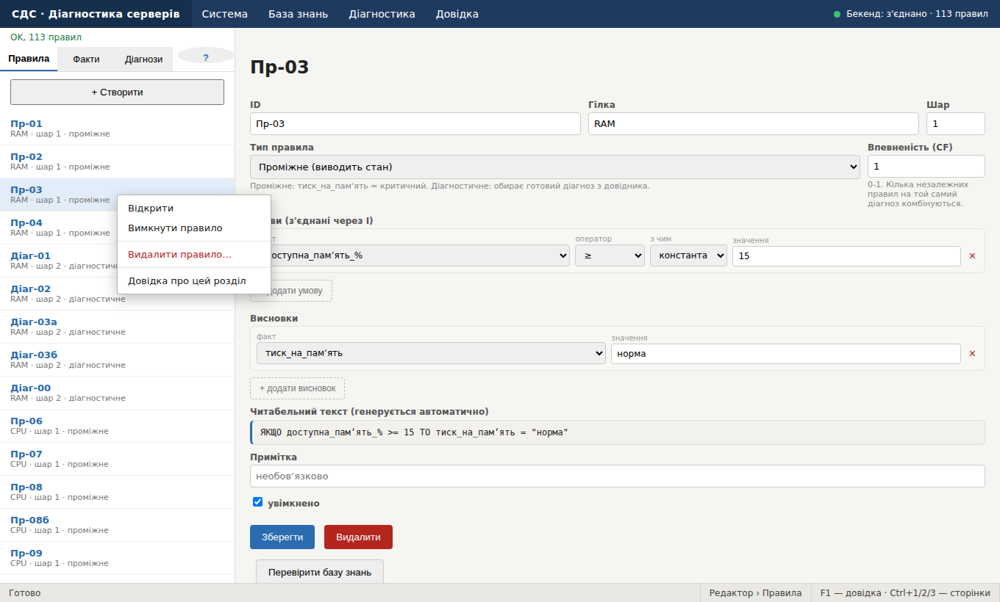
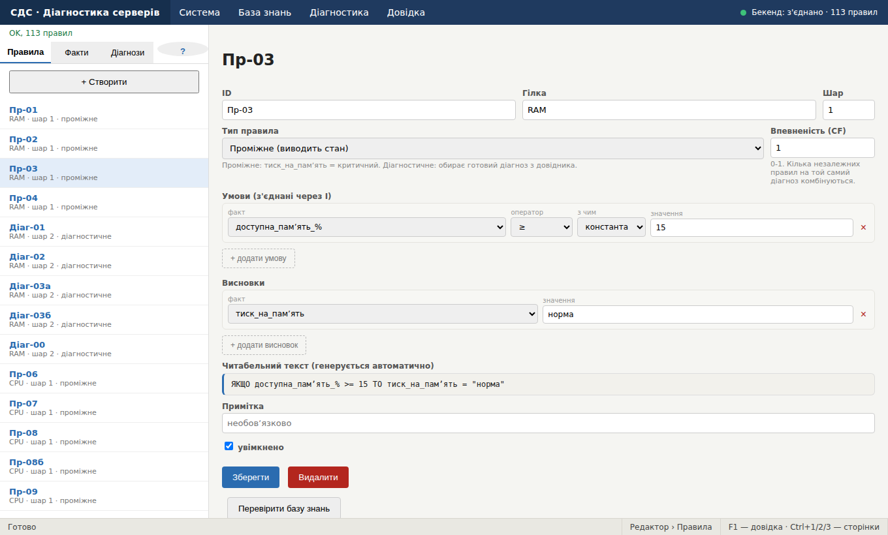
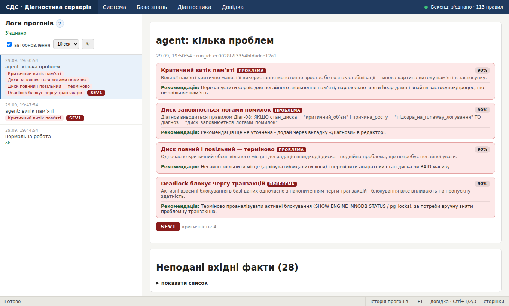

# Практична робота №2

**З дисципліни «Конструювання програмного забезпечення»**

**Тема:** Конструювання та програмування інтерфейсу програмного забезпечення, створення довідкової системи.

**Об'єкт:** система діагностики серверів (експертна система з практичної роботи №1).

**Мета:** навчитись проектувати та програмно реалізовувати інтерфейс ПЗ; створювати довідкову систему; реалізовувати основні елементи віконного інтерфейсу.

---

## 1. Основні структурні підрозділи інтерфейсу

### 1.1. Вихідні документи ПР №1 і що з них випливає для інтерфейсу

| Документ / артефакт ПР №1 | Що з нього випливає в інтерфейсі |
|---|---|
| Перелік фактів (70: вхідні й проміжні), розділ 3 звіту | Вкладка «Факти» редактора; вибір показників на сторінці «Діагностика» за схемою гілка → факт → значення |
| Продукційні правила (113 правил, шари, тип, CF) | Вкладка «Правила»: конструктор умов і висновків, вибір типу правила, поле CF |
| Довідник діагнозів (42) | Вкладка «Діагнози»; картки діагнозів у результаті |
| Машина виводу: трасування, упевненість, рівень SEV | Блоки результату: картки, SEV, спрацьовані правила, знімок памʼяті, трасування |
| Збереження прогонів (`runs`) | Сторінка «Історія прогонів» |
| Перевірка бази знань (`validate`) | Кнопка й пункт меню «Перевірити базу знань» |
| Агент моніторингу (`agent.py`) | Автооновлення списку прогонів |

### 1.2. Перелік компонентів

Інтерфейс — одне вікно-оболонка (`app.html`) з рядком меню, робочою областю, рядком стану та вікном довідки. У робочій області відкривається одна з трьох сторінок.

| № | Компонент | Призначення | Спосіб реалізації | Зв'язки |
|---|---|---|---|---|
| **Оболонка** | | | | |
| 1 | Рядок меню | Навігація й виклик команд | 4 випадні меню, 1 підменю (2 рівні) | Усі сторінки, довідка, діалог |
| 2 | Робоча область | Показує поточну сторінку | Вбудований фрейм | Керується меню, клавішами Ctrl+1/2/3 |
| 3 | Рядок стану | Підказки, поточний розділ, клавіші | Три секції внизу вікна | Змінюється при наведенні на меню й зміні контексту |
| 4 | Індикатор зв'язку з бекендом | Показує, чи доступний сервер діагностики | Кольоровий індикатор у рядку меню, опитування кожні 10 с | Пункт «Перевірити з'єднання» |
| 5 | Вікно довідки | Довідкова система | Немодальне вікно поверх робочої області | F1, меню «Довідка», кнопки «?» |
| 6 | Діалог «Про систему» | Склад бази знань | Модальний діалог | Меню «Довідка» |
| **Сторінка «Діагностика»** | | | | |
| 7 | Список показників | Введені значення | Рядки з кнопкою «×» | Контекстне меню (№13) |
| 8 | Панель додавання показника | Вибір гілки, факту й значення | Розкривна панель: два списки й поле, що залежить від типу | Дані з бази знань |
| 9 | Опції запуску | Трасування, збереження прогону, підпис | Прапорці й текстове поле | Історія прогонів |
| 10 | Кнопка «Діагностувати» | Запуск виводу | Кнопка | Область результату |
| 11 | Готові приклади | Швидке заповнення | Меню «Діагностика › Готові приклади» | Список показників |
| 12 | Область результату | Діагнози, SEV, пояснення | Картки, таблиці, розкривні блоки | Довідка (контекст «результат») |
| 13 | Контекстне меню показника | Видалити показник, довідка | Меню за правою кнопкою | Список показників |
| **Сторінка «Історія прогонів»** | | | | |
| 14 | Список прогонів | Збережені результати | Список з автооновленням (5/10/30 с) | Агент моніторингу |
| 15 | Деталі прогону | Повний результат | Область праворуч | Список |
| 16 | Контекстне меню прогону | Відкрити, копіювати ідентифікатор | Меню за правою кнопкою | Список |
| **Сторінка «Редактор бази знань»** | | | | |
| 17 | Вкладки й «+ Створити» | Вибір типу елемента | Три вкладки, кнопка | Меню «База знань» |
| 18 | Список елементів | Вибір елемента | Список | Форми |
| 19 | Контекстне меню списку | Відкрити, вимкнути, видалити, довідка | Меню за правою кнопкою | Список |
| 20 | Форма правила | Тип, CF, умови, висновки чи діагноз | Форма з конструктором умов: списки «факт», «оператор», «з чим», поле значення за типом | Довідник діагнозів |
| 21 | Форма факту | Вид, тип, одиниця, значення за замовчуванням | Форма зі списком «Вид» | Вкладка «Правила» |
| 22 | Форма діагнозу | Код, назва, критичність, опис, рекомендація | Форма | Форма правила |
| 23 | Перевірка бази знань | Пошук помилок у правилах | Кнопка й панель результату | Меню «База знань» |
| 24 | Діалоги підтвердження | Захист від випадкового видалення | Стандартні діалоги браузера | Кнопки «Видалити» |
| **Довідкова система** | | | | |
| 25 | Вкладки «Зміст / Покажчик / Пошук» | Три способи знайти тему | Панель зліва | Файл змісту, ключові слова |
| 26 | Область теми | Текст, зображення, «Див. також» | Область справа | Атрибути тем |
| 27 | Панель інструментів довідки | Сховати, Назад, `<<` `>>`, Друк, Окреме вікно, Тест | Кнопки | Історія переглядів, послідовність тем |
| 28 | Спливаюче вікно | Визначення термінів | Плаваюча підказка біля посилання | Тема з атрибутом `window: popup` |
| 29 | Вторинне вікно | Покрокові інструкції | Плаваюче вікно з власним заголовком | Тема з атрибутом `window: secondary` |
| 30 | Діалог перевірки довідки | Тест контекстної довідки | Модальний діалог | Карта контексту |

*Рис. 1. Головне вікно системи. Угорі меню й індикатор зв'язку, унизу рядок стану з поточним розділом.*

---

## 2. Сценарій діалогу

### Сценарій А. Діагностика інциденту

| Крок | Дія користувача | Реакція системи | Допоміжне повідомлення |
|---|---|---|---|
| 1 | Відкриває `app.html` | Відкривається сторінка «Діагностика» з прикладом; індикатор зв'язку зеленіє | «Готово»; «Бекенд: з'єднано · 113 правил» |
| 2 | Наводить курсор на «Діагностика › Готові приклади › Кілька проблем одночасно» | Підсвічується пункт | Підказка в рядку стану: «Чотири діагнози з різних гілок» |
| 3 | Клацає по пункту | У список підставлено показники з різних гілок | — |
| 4 | Натискає «Діагностувати» | Показується стан виконання, потім результат: чотири картки діагнозів (упевненість 90 %, «Проблема»), рівень SEV1 | «Виконується...» |
| 5 | Права кнопка миші по показнику | Відкривається контекстне меню | — |
| 6 | Обирає «Видалити показник» | Показник зникає зі списку | — |
| 7 | Натискає F1 | Сайт інструкції відкривається новою вкладкою браузера | — |

### Сценарій Б. Поповнення бази знань

| Крок | Дія користувача | Реакція системи | Допоміжне повідомлення |
|---|---|---|---|
| 1 | «База знань › Факти», кнопка «+ Створити» | Створюється факт, відкривається форма | — |
| 2 | Заповнює назву, вид «raw», тип «number», одиницю; «Зберегти» | Факт з'являється у списку | При дублікаті назви — повідомлення про конфлікт (409) |
| 3 | Вкладка «Діагнози», «+ Створити», заповнює код, назву, критичність, рекомендацію | Діагноз з'являється у довіднику | «Критичність має бути числом від 1 до 4.»; «Код і назва обовʼязкові.» |
| 4 | Вкладка «Правила», «+ Створити», тип «Діагностичне», «+ додати умову» | З'являється рядок умови зі списками | — |
| 5 | Обирає діагноз у списку, «Зберегти» | Правило збережено | «Додай хоча б одну умову.»; «Обери діагноз зі списку …»; «Впевненість (CF) має бути числом від 0 до 1.» |
| 6 | «База знань › Перевірити базу знань» | Показується результат перевірки | `total_problems: 0` означає, що база справна |
| 7 | Сторінка «Діагностика», F5, додає новий показник і запускає діагностику | У результаті з'являється новий діагноз | — |

### Сценарій В. Отримання довідки

| Крок | Дія користувача | Реакція системи |
|---|---|---|
| 1 | Меню «Довідка» або F1 | Сайт інструкції відкривається новою вкладкою (якщо `serve_manual.py` не запущено - підказка в рядку стану, що саме запустити) |
| 2 | У полі пошуку вгорі вводить «CF» | Список збігів звужується на льоту |
| 3 | Клацає результат «Впевненість правила (CF)» | Відкривається файл `knowledge-base.md`, сторінка прокручується до потрібного підрозділу |
| 4 | У тексті клацає посилання «Як додати новий факт» | Відкривається файл `howto.md` з покроковою інструкцією |

---

## 3. Допоміжні повідомлення та їх зв'язок із компонентами

Допоміжні повідомлення поділяються на п'ять видів: підказки меню в рядку стану, тултіпи кнопок, інформаційні написи, повідомлення про помилки, діалоги.

### 3.1. Підказки меню (рядок стану, компонент №3)

Меню містить 17 пунктів, з них один відкриває підменю. Під час наведення курсора на пункт у рядку стану з'являється підказка.

| Меню | Пункт | Клавіші | Підказка в рядку стану | Дія |
|---|---|---|---|---|
| Система | Діагностика | Ctrl+1 | Ввести показники сервера та запустити діагностику | відкриває «Діагностика» |
| Система | Історія прогонів | Ctrl+2 | Переглянути збережені результати діагностики | відкриває «Історія прогонів» |
| Система | Редактор бази знань | Ctrl+3 | Редагувати правила, факти та діагнози | відкриває «Редактор бази знань» |
| Система | Перевірити з'єднання з бекендом |  | Перевірити, чи відповідає сервер діагностики | перевірка з'єднання з бекендом |
| Система | Оновити поточне вікно | F5 | Перезавантажити робочу область | перезавантаження поточної сторінки |
| База знань | Правила |  | Відкрити редактор на вкладці «Правила» | відкриває «Редактор бази знань», вкладка «Правила» |
| База знань | Факти |  | Відкрити редактор на вкладці «Факти» | відкриває «Редактор бази знань», вкладка «Факти» |
| База знань | Діагнози |  | Відкрити редактор на вкладці «Діагнози» | відкриває «Редактор бази знань», вкладка «Діагнози» |
| База знань | Перевірити базу знань |  | Знайти помилки в правилах і фактах без запуску діагностики | відкриває «Редактор бази знань» і запускає перевірку |
| Діагностика | Нова діагностика |  | Очистити список показників і почати спочатку | відкриває «Діагностика», очищує список показників |
| Діагностика | Готові приклади ▸ |  | Підставити готовий набір показників | підменю (другий рівень) |
| Діагностика | &nbsp;&nbsp;▸ Усе в нормі |  | Здоровий сервер: діагнозів немає | відкриває «Діагностика» з готовим прикладом |
| Діагностика | &nbsp;&nbsp;▸ Критичний витік памʼяті |  | Один підтверджений діагноз, SEV1 | відкриває «Діагностика» з готовим прикладом |
| Діагностика | &nbsp;&nbsp;▸ Кілька проблем одночасно |  | Чотири діагнози з різних гілок | відкриває «Діагностика» з готовим прикладом |
| Діагностика | Історія прогонів |  | Переглянути збережені результати діагностики | відкриває «Історія прогонів» |
| Довідка | Інструкція користувача | F1 | Відкрити інструкцію в новій вкладці (потрібен запуск help/serve_manual.py та інтернет) | відкриває сайт інструкції (Docsify) у новій вкладці |
| Довідка | Про систему |  | Версія та склад системи | діалог «Про систему» |

*Рис. 2. Випадне меню другого рівня.*

### 3.2. Тултіпи кнопок

| Компонент | Текст підказки |
|---|---|
| Кнопка «+ Створити» (№17) | Створити новий елемент на активній вкладці |
| Вкладка «Правила» (№17) | Правила виводу: умови і висновки |
| Вкладка «Факти» (№17) | Факти: вхідні показники та проміжні стани |
| Вкладка «Діагнози» (№17) | Довідник діагнозів: назва, критичність, рекомендація |
| Кнопка «Перевірити базу знань» (№23) | Знайти помилки в правилах і фактах без запуску діагностики |
| Кнопка «+ Додати показник» (№8) | Обрати гілку, факт і значення показника |
| Кнопка «Діагностувати» (№10) | Прогнати показники через правила й показати діагнози |
| Кнопка «?» на сторінках (№5) | Довідка (F1) |
| Кнопки довідки «Сховати», «Назад», «<<», «>>», «Друк», «Окреме вікно», «Тест» (№27) | Відповідні описи дії |

### 3.3. Інформаційні повідомлення й повідомлення про помилки

| Компонент | Повідомлення | Вид |
|---|---|---|
| Діагностика, список показників (№7) | «Ще не додано жодного показника.» | Порожній стан |
| Діагностика, область результату (№12) | «Жодного діагнозу — система в нормі.» | Інформація |
| Діагностика, область результату (№12) | «Виконується...» | Стан виконання |
| Діагностика, область результату (№12) | «Помилка: …» (текст відповіді сервера) | Помилка |
| Форма правила (№20) | «Додай хоча б одну умову.» | Помилка валідації |
| Форма правила (№20) | «Додай хоча б один висновок.» | Помилка валідації |
| Форма правила (№20) | «Обери діагноз зі списку (або спершу додай його на вкладці «Діагнози»).» | Помилка валідації |
| Форма правила (№20) | «Впевненість (CF) має бути числом від 0 до 1.» | Помилка валідації |
| Форма діагнозу (№22) | «Критичність має бути числом від 1 до 4.» | Помилка валідації |
| Форма діагнозу (№22) | «Код і назва обовʼязкові.» | Помилка валідації |
| Кнопка «+ Створити» (№17) | «Не вдалося створити: …» | Помилка (вікно) |
| Історія прогонів (№14) | «Ще немає збережених прогонів. …» | Порожній стан |
| Історія прогонів (№14) | «Помилка завантаження: …» | Помилка |
| Усі сторінки | «Немає з'єднання з бекендом (localhost:8000)» | Помилка зв'язку |
| Рядок стану (№3) | «З'єднання з бекендом у порядку (правил у базі: N).» | Інформація |
| Рядок стану (№3) | «Бекенд недоступний. Перевірте, чи запущено uvicorn (порт 8000).» | Помилка зв'язку |
| Довідка, макрос поза оболонкою (№26) | «Ця дія доступна лише з головного вікна системи.» | Інформація |

### 3.4. Діалоги

| Діалог | Коли з'являється | Кнопки |
|---|---|---|
| «Про систему» (№6) | Меню «Довідка › Про систему» | OK, Esc |
| «Видалити правило?» / «Видалити факт?» | Кнопка «Видалити», пункт контекстного меню (№24) | Так, Ні |
| «Видалити діагноз? Правила, що на нього посилаються, залишаться з некоректним кодом …» | Видалення діагнозу (№24) | Так, Ні |

*Рис. 3. Діалог «Про систему» (склад бази знань береться з бекенда).*

---

## 4. Дерево й сітка переходів діалогу (графічна модель інтерфейсу)

Дерево, мережа переходів і сітка генеруються скриптом `docs/pr2/build_dialog_tree.py` з одного списку зв'язків, тому рисунки й таблиця узгоджені між собою.

*Рис. 4. Дерево діалогу: склад і вкладеність компонентів.*

*Рис. 5. Мережа переходів. Ребра підписані подією, що викликає перехід.*

### Сітка переходів

Рядок — звідки, стовпчик — куди; у клітинці — подія, що викликає перехід. Прочерк означає, що прямого переходу немає.

| Звідки ↓ / Куди → | Головне вікно | Діагностика | Історія прогонів | Редактор | Довідка | Про систему | Підтвердження видалення | Контекстне меню |
|---|---|---|---|---|---|---|---|---|
| **Головне вікно** | клік по меню; Перевірити з'єднання | старт програми; Ctrl+1; Нова діагностика · Готові приклади | Ctrl+2; Історія прогонів | Ctrl+3; Правила; Факти; Діагнози; Перевірити базу знань | F1 · меню; Інструкція користувача · F1 | Про систему | — | — |
| **Діагностика** | — | + Додати показник; Додати · Скасувати; Діагностувати | — | — | F1 · «?» | — | — | права кнопка |
| **Історія прогонів** | — | — | клік по прогону | — | F1 · «?» | — | — | права кнопка |
| **Редактор** | — | — | — | вкладка; клік по правилу · + Створити; клік по факту · + Створити; клік по діагнозу · + Створити; Перевірити базу знань | F1 · «?» | — | Видалити | права кнопка |
| **Довідка** | — | — | — | — | — | — | — | — |
| **Про систему** | OK · Esc | — | — | — | — | — | — | — |
| **Підтвердження видалення** | — | — | — | Так · Ні | — | — | — | — |
| **Контекстне меню** | — | Видалити показник | Відкрити прогін | Відкрити; Вимкнути / Увімкнути правило | Довідка про розділ | — | Видалити… | — |

**Обмеження вкладеності.** Меню мають два рівні (меню → підменю). Довідка відкривається окремою вкладкою браузера, а не вкладеним вікном програми. Діалоги не відкривають нових діалогів.

---

## 5. Довідкова система

### 5.1. Вибір засобу

Завдання дозволяє створити довідку «за допомогою WinHelp або іншої програми». Формат WinHelp (`.hlp`) застарів: починаючи з Windows 10 переглядач WinHlp32 не постачається разом із системою, а Microsoft Help Workshop з інструментами Delphi давно не підтримується.

Довідку зроблено на **Docsify** — готовому, стандартному генераторі документації з Markdown-файлів, без власного коду для показу тем. Причина того, чому обрано саме готовий інструмент, а не написання власного переглядача: завдання методики можна закрити значно простішим, стандартним засобом, і це прозоріше для перевірки, ніж саморобний код.

Docsify не потребує збірки: він читає `.md`-файли напряму в браузері під час відкриття сторінки, тому єдина «компіляція» — це запуск локального сервера, що просто віддає файли по HTTP (сам Docsify підвантажується з CDN, для цього потрібен інтернет).

### 5.2. Структура

| Файл | Призначення |
|---|---|
| `help/src/start.md` | Про систему, запуск системи, швидкий старт, головне вікно, гарячі клавіші |
| `help/src/diagnostics.md` | Сторінка «Діагностика», додавання показника, результат, рівні діагнозу, SEV |
| `help/src/knowledge-base.md` | Факти, правила, типи правил, умови, CF, довідник діагнозів, перевірка бази знань |
| `help/src/logs.md` | Історія прогонів, збереження прогону, агент моніторингу |
| `help/src/howto.md` | Покрокові інструкції: додати факт, додати діагностичне правило, правило на два шари, змінити чи видалити |
| `help/src/reference.md` | Словник термінів, повідомлення системи, помилки з'єднання й збереження, про програму |
| `help/src/_sidebar.md` | Зміст (список посилань на шість файлів вище) |
| `help/src/index.html` | Точка входу: підключає Docsify та пошук |
| `help/serve_manual.py` | Локальний сервер для перегляду (Docsify читає файли по HTTP, не з диска напряму) |

Матеріал згруповано у шість великих файлів за розділами — не по темі на файл, щоб пов'язані відомості (наприклад, усе про факти й правила) були в одному місці, а не розкидані по кількох вкладках.

### 5.3. Як це працює

Кожен `.md`-файл — це звичайний Markdown: заголовки `#`/`##`, таблиці, списки, посилання на інші файли з шести. Ніяких особливих позначень чи блоків метаданих файли не містять — Docsify читає їх так само, як прочитав би людина.

Запуск: `python help/serve_manual.py` піднімає сервер на `localhost:3000` і відкриває сторінку в браузері. У головному меню програми (`app.html`) пункт «Довідка» і клавіша F1 відкривають цю сторінку новою вкладкою. Якщо сервер довідки не запущено, замість помилки система показує підказку в рядку стану, що саме треба запустити.

### 5.4. Відповідність пунктам завдання

| Вимога методики (WinHelp) | Стан |
|---|---|
| Файли тем, зміст, компіляція, переглядач | Реалізовано на Docsify: `.md`-файли, `_sidebar.md`, читання напряму без компіляції, вбудований переглядач Docsify |
| Перехід між темами | Реалізовано — звичайні посилання Markdown |
| Пошук по темах | Реалізовано — вбудований плагін пошуку Docsify |
| Виклик довідки з програми, пункт меню «Довідка» | Реалізовано — меню й F1 відкривають сайт новою вкладкою |
| Кілька тем у спливаючих і вторинних вікнах (*) | **Не реалізовано.** Docsify не має цих типів вікон; усі теми відкриваються як звичайні сторінки того самого сайту |
| Контекстна довідка: виклик з конкретного місця програми відкриває саме ту тему (*) | **Не реалізовано.** F1 і меню завжди відкривають сайт на його головній сторінці, без урахування того, де в програмі перебуває користувач |
| Налаштування проєкту довідки (мова, кілька вікон, папка зображень) (*) | Частково: мова й папка зображень є (налаштування Docsify в `index.html`), кількох вікон немає, бо немає самих вікон |

Три пункти зі знаком `*` (на «добре»/«відмінно») свідомо не реалізовані — обраний інструмент їх не підтримує, і написання їх власним кодом суперечило б рішенню користуватись готовим, а не саморобним засобом.

---

## 6. Програмна реалізація інтерфейсу

### 6.1. Склад

| Файл | Призначення |
|---|---|
| `app.html` | Оболонка: меню, рядок стану, діалог, гарячі клавіші |
| `diagnose.html`, `logs.html`, `editor.html` | Сторінки; працюють і в оболонці, і окремо |
| `help/src/` | Шість тем довідки, зміст, точка входу Docsify |
| `help/serve_manual.py` | Локальний сервер для перегляду довідки |
| `docs/pr2/build_dialog_tree.py` | Генератор графічної моделі інтерфейсу |
| `tests/ui/` | Автоматичні тести інтерфейсу |

### 6.2. Взаємодія сторінок і оболонки

Сторінки й оболонка обмінюються повідомленнями (`postMessage`), тому не залежать одна від одної:

| Напрямок | Повідомлення | Призначення |
|---|---|---|
| Сторінка → оболонка | `context` | Повідомляє поточний розділ (для рядка стану) |
| Сторінка → оболонка | `key` | Пересилає F1, F5, Ctrl+1/2/3, Esc |
| Сторінка → оболонка | `help` | Просить відкрити сайт інструкції |
| Оболонка → сторінка | `cmd` | Команда з меню: вкладка, приклад, очищення, перевірка |

Початковий стан сторінки можна задати параметрами в адресі, наприклад `editor.html#tab=facts` або `diagnose.html#example=memory`.

### 6.3. Контекстні меню

Реалізовано три: для елементів списку в редакторі (відкрити, увімкнути чи вимкнути правило, видалити, довідка), для показника в діагностиці і для прогону в історії.

*Рис. 6. Контекстне меню елемента списку правил.*

*Рис. 7. Редактор бази знань: форма правила з конструктором умов.*

*Рис. 8. Сторінка «Історія прогонів».*

### 6.4. Виявлені під час тестування вади й виправлення

Автоматичні тести в справжньому браузері виявили вади, яких не видно під час поверхового огляду:

| Вада | Виправлення |
|---|---|
| Підписи на схемі переходів спотворювались (`\E` у Graphviz сприймався як ім'я ребра) | Виправлено формування підписів у `build_dialog_tree.py` |
| `serve_manual.py` змінили на роздачу тільки `help/src/`, а адреса сайту в `app.html` (`MANUAL_URL`) ще вказувала на старий шлях з префіксом `/help/src/` | Адресу в `app.html` узгоджено із сервером; перевірку закріплено тестом, що реально відкриває нову вкладку й звіряє її адресу |

### 6.5. Автоматична перевірка

`python tests/ui/run_ui_tests.py` запускає тестовий бекенд на справжній машині виводу й проганяє 71 перевірку: 32 для оболонки й сторінок (меню, підменю, підказки, навігація, контекст, контекстні меню, F1, діалог, автономна робота сторінки, відкриття сайту довідки новою вкладкою) і 39 для самого сайту довідки (`test_manual.py`: вміст шести тем, зміст, `index.html`, і те, що `serve_manual.py` реально піднімається й віддає файли по HTTP з правильними типами). Усі проходять. Тести машини виводу (`tests/test_engine.py`, 58 перевірок) також проходять - разом 129.

---

## 7. Відповіді на контрольні запитання

**1. Дайте визначення інтерфейсу користувача, його призначення та характеристики.**

Інтерфейс користувача — це сукупність засобів і правил, за допомогою яких людина взаємодіє з програмою: візуальні елементи, засоби введення, реакції системи й повідомлення. Призначення — забезпечити введення даних, керування функціями та відображення результатів так, щоб користувач досягав мети швидко й без помилок. Основні характеристики: легкість вивчення, ефективність роботи, запам'ятовуваність, кількість і серйозність помилок, суб'єктивне задоволення, узгодженість, наявність зворотного зв'язку.

**2. Визначте основні вимоги до інтерфейсів.**

Простота й мінімалізм; узгодженість (однакові елементи поводяться однаково); зворотний зв'язок на кожну дію; можливість скасувати дію й захист від помилок; зрозумілі повідомлення про помилки; розпізнавання замість пригадування (підказки, списки замість вільного введення); гнучкість (гарячі клавіші для досвідчених користувачів); наявність довідки; адаптація до типу користувача; швидка реакція. У системі це реалізовано так: списки замість вільного введення в конструкторі умов, підтвердження видалення, підказки в рядку стану, F1 як швидкий доступ до довідки.

**3. Які підходи до проектування інтерфейсу ви знаєте?**

За типом діалогу: командний рядок, меню, заповнення форм, пряма маніпуляція (графічний інтерфейс), природна мова. За методом проектування: «зверху вниз» (від загальної структури до деталей) і «знизу вгору»; проектування, орієнтоване на користувача, з ітераційним прототипуванням і тестуванням; сценарний підхід (інтерфейс виводиться зі сценаріїв роботи); об'єктно-орієнтований підхід (інтерфейс будується навколо об'єктів предметної галузі). У роботі використано сценарний підхід: спочатку складено сценарії діалогу (розділ 2), потім визначено допоміжні повідомлення й схему переходів.

**4. Визначте основні компоненти інтерфейсу. Призначення та побудова кожного з них.**

- **Вікно** — область, у якій відображається програма або її частина (у системі: оболонка програми; довідка відкривається окремою вкладкою браузера).
- **Меню** — перелік команд: рядок меню, випадне, контекстне (у системі: 4 меню, підменю, 3 контекстні меню).
- **Діалогове вікно** — короткий обмін інформацією, модальне або немодальне (у системі: «Про систему», підтвердження).
- **Елементи керування** — кнопки, поля введення, списки, прапорці, перемикачі, вкладки, дерева (у системі: конструктор умов, вкладки редактора, дерево змісту довідки).
- **Рядок стану** — постійне місце для підказок і поточного стану.
- **Підказки й повідомлення** — тултіпи, інформаційні написи, повідомлення про помилки.
- **Довідка** — довідкова система (у системі: сайт на Docsify, відкривається з меню чи по F1).

**5. Яким є обмеження на рівень вкладеності для системи меню та вікон?**

Зазвичай рекомендують не більше двох-трьох рівнів вкладеності меню й не більше двох-трьох рівнів вікон, що відкриваються одне з іншого: глибша вкладеність утруднює навігацію й збільшує навантаження на пам'ять. У системі меню мають два рівні (меню → підменю «Готові приклади»); вікно в системі одне - головне вікно програми, довідка не вкладена в нього, а відкривається окремою вкладкою браузера.

---

## Висновки

Спроєктовано й реалізовано інтерфейс системи діагностики серверів: єдине вікно-оболонку з меню, рядком стану, контекстними меню й гарячими клавішами, що об'єднує три сторінки з практичної роботи №1. Структуру інтерфейсу виведено з документів попередньої роботи: факти, правила, діагнози, результати виводу, історія прогонів.

Складено сценарії діалогу, визначено допоміжні повідомлення й зв'язано їх з компонентами, побудовано дерево й сітку переходів (розділ 4). Ці графічні моделі генеруються з одного списку зв'язків, тому не розходяться між собою.

Створено довідкову систему на Docsify: шість тем, зміст, повнотекстовий пошук, звичайні переходи Markdown. Замість застарілого WinHelp і замість написання власного переглядача застосовано готовий, стандартний інструмент. Три пункти методики зі знаком «*» (спливаючі й вторинні вікна, контекстна довідка) свідомо не реалізовані, бо обраний інструмент їх не підтримує (розділ 5.4).

Реалізацію перевірено автоматично в справжньому браузері: 129 перевірок інтерфейсу, довідки й машини виводу разом (58 - машина виводу, 32 - оболонка, 39 - сайт довідки, включно з реальним запуском `serve_manual.py` і перевіркою, що по F1 чи з меню реально відкривається нова вкладка). Тестування виявило кілька вад під час попередніх ітерацій (розділ 6.4), які виправлено.

**Обмеження.** Саму бібліотеку Docsify (JavaScript, що підвантажується з CDN) автоматичним тестом не перевірено - для цього потрібне реальне інтернет-з'єднання в браузері користувача; перевірено те, що піддається автоматичній перевірці без мережі: вміст тем, коректність посилань, роботу локального сервера. У частині діагнозів опис і рекомендація ще містять типовий текст-заглушку; їх можна доповнити на вкладці «Діагнози» без змін коду.

---

## Додаток. Документи та їх взаємозв'язки

| Документ | Файл | Пов'язаний з |
|---|---|---|
| Звіт ПР №1 (розділи 1–4) | `docs/REPORT_*.md` | Джерело структури інтерфейсу (розділ 1) |
| База знань | `data/knowledge_base.json` | Редактор, діагностика, довідка |
| Графи AND/OR | `docs/graphs/*.pdf` | Звіт ПР №1 |
| Звіт ПР №2 | `docs/pr2/REPORT_PR2.md`, `.docx` | Цей документ |
| Графічна модель інтерфейсу | `docs/pr2/img/dialog_*.png`, `build_dialog_tree.py` | Розділ 4 |
| Довідка: теми, зміст, точка входу | `help/src/` | Сайт на Docsify, відкривається з `app.html` |
| Сервер для перегляду довідки | `help/serve_manual.py` | `help/src/` |
| Тести | `tests/ui/`, `tests/test_engine.py` | Розділи 5.2 і 6.5 |
