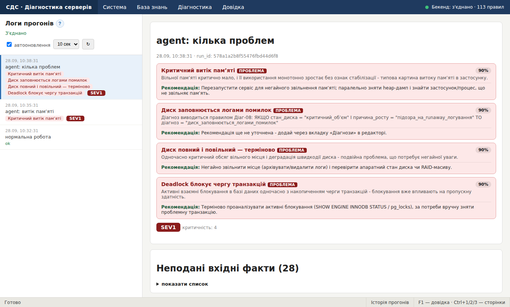

# Історія прогонів

## Сторінка «Історія прогонів»

Ліворуч — список збережених прогонів діагностики від найновіших: час, підпис, назви діагнозів і рівень SEV. Клік по рядку відкриває докладний результат праворуч — такий самий, як на сторінці «Діагностика» ([Як читати результат](diagnostics.md)).

Список **оновлюється автоматично** (перемикач і інтервал 5/10/30 секунд угорі) — так можна спостерігати за агентом моніторингу наживо. Кнопка ↻ оновлює вручну.

Прогін зʼявляється в історії, якщо під час діагностики ввімкнено збереження. Контекстне меню рядка: відкрити, копіювати ідентифікатор.




## Як зберегти прогін в історію

На сторінці «Діагностика» поставте прапорець **зберегти прогін в історію** і за бажанням впишіть **підпис прогону** (наприклад, «після деплою»). Після натискання **Діагностувати** прогін зʼявиться в історії.

Агент моніторингу зберігає прогони автоматично; його підпис починається з `agent:` і містить назву машини та час.

## Агент моніторингу

Агент моніторингу — окрема програма, яка сама через певний інтервал знімає показники комп'ютера й надсилає їх на діагностику. Результати зберігаються в історії прогонів, тож за роботою системи можна спостерігати без ручного введення.

### Запуск

1. Один раз встановіть бібліотеки:

```
pip install psutil requests
```

2. Переконайтеся, що сервер діагностики запущено ([Запуск системи](start.md)).
3. У корені проєкту виконайте:

```
python agent/agent.py --interval 30
```

4. Відкрийте сторінку «Історія прогонів»: нові рядки зʼявляються кожні 30 секунд, якщо ввімкнено автооновлення списку.

Зупинити агента можна комбінацією Ctrl+C.


### Параметри

| Параметр | Значення | За замовчуванням |
|---|---|---|
| `--url` | Адреса API сервера діагностики | `http://localhost:8000/api` |
| `--interval` | Інтервал між надсиланнями, секунди | 30 |
| `--no-save` | Не зберігати прогони в історію | прогони зберігаються |

### Які показники надсилає агент

**Реальні**, зняті з комп'ютера, де запущено агента: завантаження процесора, кількість ядер, load average, вільна памʼять, swap, заповненість диска, дискова активність, вхідний мережевий трафік і, якщо є датчик, температура процесора.

**Умовні.** Показників бази даних, мережі та каскадів агентові знімати нізвідки, тому для них він підставляє значення «здорового» сервера. Аномалія в таких значеннях трапляється дуже рідко, тож справжнє навантаження на комп'ютер не тоне в шумі.

Список показників агент щоразу бере з сервера, тому новий вхідний показник, доданий у редакторі, він теж надсилатиме. Для показника, який агент не знає, значення випадкове: для чисел від 0 до 100.
