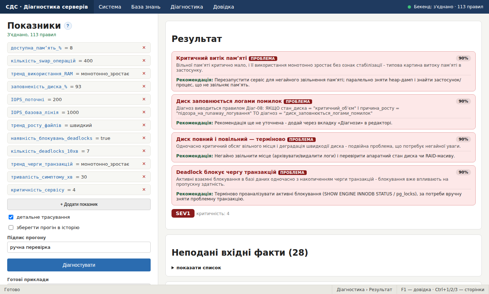

# Початок роботи

## Про систему

Система діагностики серверів — це **експертна система** на продукційних правилах. Вона отримує показники сервера (завантаження процесора, вільна памʼять, заповненість диска тощо), прогонює їх через базу знань і повідомляє, **що з сервером не так** і **наскільки це термінове**.

Що система вміє:

- знаходити кілька проблем одночасно, а не лише одну;
- оцінювати впевненість у кожному діагнозі (див. [CF](reference.md));
- визначати рівень інциденту [SEV](reference.md) з урахуванням важливості сервера й тривалості проблеми;
- пояснювати, які правила привели до висновку ([трасування](reference.md));
- дозволяти експерту поповнювати базу знань без програмування — через [редактор](knowledge-base.md).

Система складається з трьох сторінок, що відкриваються в одному вікні: [Діагностика](diagnostics.md), [Історія прогонів](logs.md) та [Редактор бази знань](knowledge-base.md). Про будову вікна — у розділі Головне вікно.

> Новачкам: почніть зі Швидкого старту.

## Запуск системи

Для роботи потрібні Python і база даних MongoDB (хмарна Atlas або локальна).

### Один раз: підготовка

1. Встановіть залежності. У папці `backend` виконайте:

```
pip install -r requirements.txt
```

2. Скопіюйте файл `.env.example` у `.env` і впишіть рядок підключення до MongoDB:

```
MONGO_URI=mongodb://localhost:27017/
MONGO_DB=expert_system
```

Для локальної MongoDB достатньо цих значень. Для хмарної Atlas підставте свій рядок підключення й додайте свою IP-адресу в розділі Network Access, інакше з'єднання буде відхилено.

3. Завантажте базу знань у MongoDB (у папці `backend`):

```
python seed_kb.py
```

### Щоразу: запуск

4. У папці `backend` запустіть сервер:

```
py -m uvicorn main:app --reload --port 8000
```

5. Відкрийте файл `app.html` у браузері. Зелений індикатор угорі й напис «Бекенд: з'єднано» означають, що все працює. Якщо цього напису немає, дивіться [Немає з'єднання з бекендом](reference.md).

> Команда `python seed_kb.py --force` повністю перезаписує правила, факти й діагнози даними з файлу `data/knowledge_base.json` без питання. Усі зміни, зроблені в редакторі, буде втрачено. Історія прогонів не змінюється.

Далі: Швидкий старт.

## Швидкий старт

Система має бути запущена (див. Запуск системи).

1. Відкрийте пункт меню **Діагностика › Готові приклади › Критичний витік памʼяті**.
2. Натисніть кнопку **Діагностувати**.
3. Праворуч зʼявиться картка діагнозу «Критичний витік памʼяті» з упевненістю 90 %, описом і рекомендацією, а нижче — рівень інциденту **SEV1**.
4. Натисніть **F1** — довідка відкриється саме на темі про результат діагностики.

Хочете ввести свої показники? Дивіться [Додавання показника](diagnostics.md).

Перейти до діагностики просто зараз: [Відкрити сторінку «Діагностика»](diagnostics.md).

## Головне вікно

Головне вікно складається з чотирьох частин:

| Частина | Призначення |
|---|---|
| Рядок меню (угорі) | Чотири меню: **Система**, **База знань**, **Діагностика**, **Довідка**. Праворуч — індикатор зв'язку з бекендом |
| Робоча область | Одна з трьох сторінок: діагностика, історія прогонів або редактор |
| Рядок стану (внизу) | Підказка до пункту меню, над яким стоїть курсор; поточний розділ; нагадування про гарячі клавіші |
| Вікно довідки | Відкривається поверх робочої області по F1 або з меню **Довідка** |



Меню мають не більше двох рівнів вкладеності. Другий рівень є лише у пункту **Діагностика › Готові приклади**.


Див. також: Гарячі клавіші й контекстне меню, [Повідомлення системи](reference.md).

## Гарячі клавіші й контекстне меню

### Гарячі клавіші

| Клавіші | Дія |
|---|---|
| F1 | Довідка про поточний розділ (контекстна довідка) |
| Ctrl+1 | Сторінка «Діагностика» |
| Ctrl+2 | Сторінка «Історія прогонів» |
| Ctrl+3 | Сторінка «Редактор бази знань» |
| F5 | Оновити поточну сторінку |
| Esc | Закрити довідку, діалог чи меню |

### Контекстне меню (права кнопка миші)

- **Список правил, фактів чи діагнозів у редакторі:** Відкрити · Увімкнути/Вимкнути (лише для правил) · Видалити · Довідка про цей розділ.
- **Показник у діагностиці:** Видалити показник · Довідка про показники.
- **Прогін в історії:** Відкрити · Копіювати ідентифікатор · Довідка.


